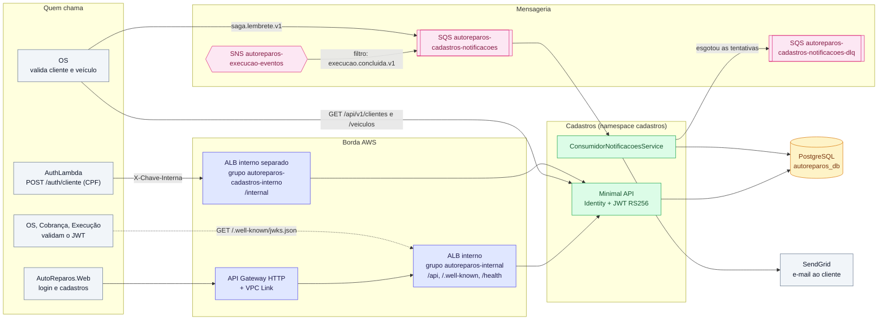
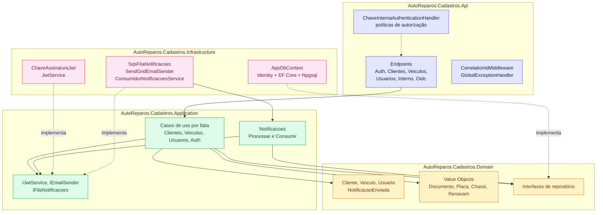
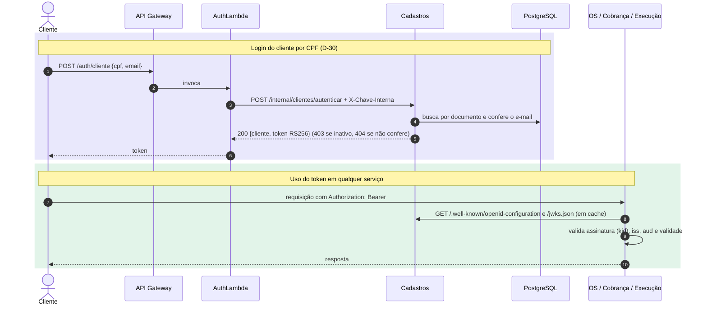
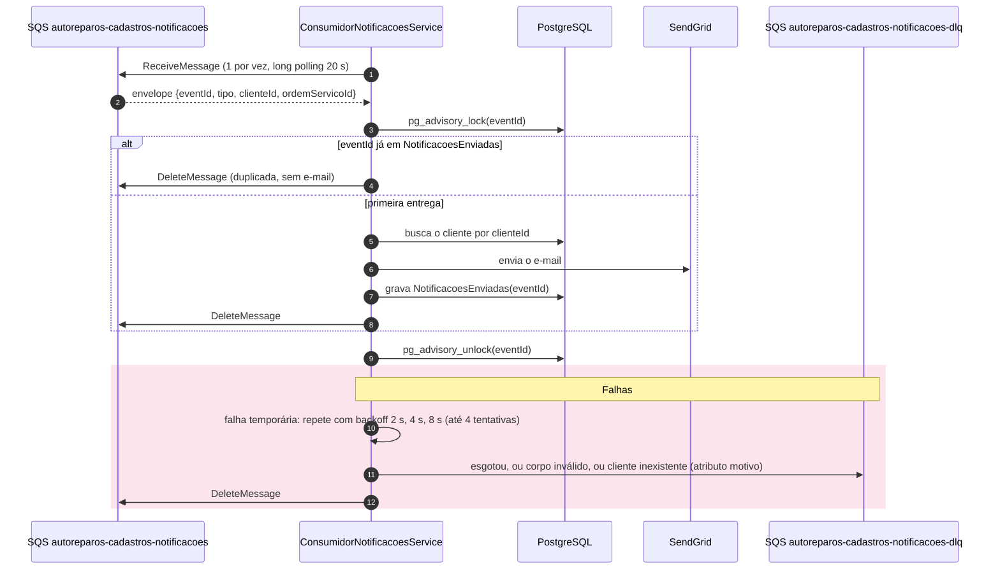
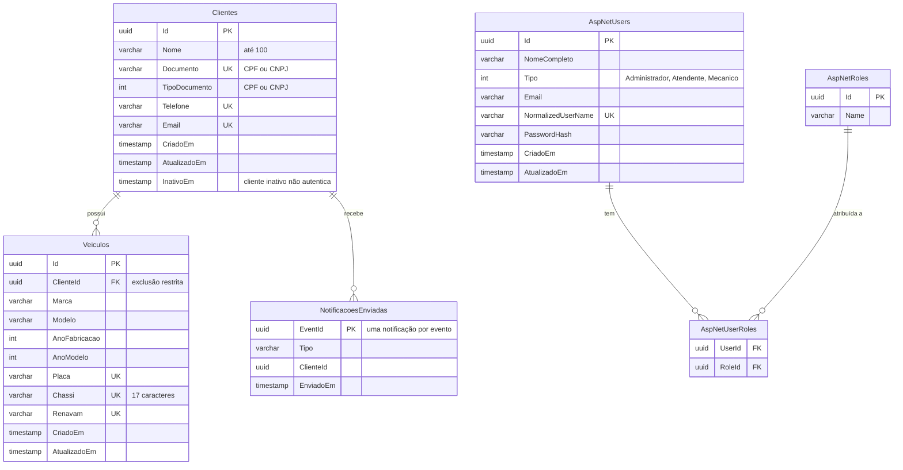
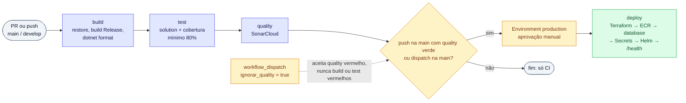

# AutoReparos.Cadastros

> Microsserviço de **Cadastros e Identidade** do AutoReparos, sistema de gestão de oficina mecânica do Tech Challenge FIAP SOAT (Fase 4: microsserviços, Saga Pattern e CI/CD).

[](https://github.com/Grupo78-PosTech-15SOAT/AutoReparos.Cadastros/actions/workflows/ci-cd.yml)
[](https://sonarcloud.io/project/overview?id=Grupo78-PosTech-15SOAT_AutoReparos.Cadastros)
[](https://sonarcloud.io/component_measures?id=Grupo78-PosTech-15SOAT_AutoReparos.Cadastros&metric=coverage)

| | |
|---|---|
| **Stack** | .NET 10 (ASP.NET Core Minimal APIs), EF Core 10 + Npgsql, ASP.NET Core Identity, PostgreSQL 16, AWS SDK (SQS), SendGrid, OpenTelemetry |
| **Banco** | PostgreSQL próprio: database `autoreparos_db` com o usuário `cadastros_app` no RDS (D-34); `cadastros_db` só no ambiente local |
| **Identidade** | Emissor do JWT **RS256** de usuários e clientes; publica discovery OIDC e JWKS para OS, Cobrança e Execução |
| **Mensageria** | Fila própria `autoreparos-cadastros-notificacoes` (SQS + DLQ), assinante do tópico SNS `autoreparos-execucao-eventos` |
| **Produção** | EKS `AutoReparosEKS` (us-east-1), namespace `cadastros`, atrás do API Gateway `https://8afyzjqfk2.execute-api.us-east-1.amazonaws.com` |

## Sumário

1. [Visão geral](#1-visão-geral)
2. [Arquitetura](#2-arquitetura)
3. [Autenticação: JWT RS256, JWKS e chave interna](#3-autenticação-jwt-rs256-jwks-e-chave-interna)
4. [API REST](#4-api-rest)
5. [Notificações por evento](#5-notificações-por-evento)
6. [Relação com a Saga](#6-relação-com-a-saga)
7. [Banco de dados](#7-banco-de-dados)
8. [Observabilidade](#8-observabilidade)
9. [Como rodar localmente](#9-como-rodar-localmente)
10. [Testes](#10-testes)
11. [Cobertura e qualidade](#11-cobertura-e-qualidade)
12. [CI/CD e deploy](#12-cicd-e-deploy)
13. [Configuração](#13-configuração)
14. [Repositórios do projeto](#14-repositórios-do-projeto)

---

## 1. Visão geral

O Cadastros nasceu do aplicativo monolítico das fases anteriores e, na Fase 4, ficou só com o que é **cadastro e identidade** (D-01, D-23). Ordens de serviço, orçamentos, catálogo e insumos saíram para os serviços OS, Cobrança e Execução; a migration `v9_remove_tabelas_migradas` apagou essas tabelas, e um teste prova que nenhuma rota ou tabela migrada voltou.

| Responsabilidade | Como o serviço atende |
|---|---|
| Clientes e veículos | CRUD com validação de CPF/CNPJ, telefone, e-mail, placa (padrão antigo e Mercosul), chassi e Renavam; unicidade garantida no banco |
| Usuários da oficina | CRUD de `Administrador`, `Atendente` e `Mecanico` sobre ASP.NET Core Identity; login por e-mail e senha |
| Emissão de identidade | JWT RS256 com `kid`, discovery OIDC e JWKS públicos; os outros serviços validam sem segredo compartilhado (D-21) |
| Autenticação do cliente | Rota interna `POST /internal/clientes/autenticar` chamada pela AuthLambda (CPF + e-mail), protegida por `X-Chave-Interna` (D-30) |
| Consulta para outros serviços | `GET /api/v1/clientes/{id}` e `GET /api/v1/veiculos/{id}`, usados pelo OS para validar a abertura da OS |
| Notificação ao cliente | Consome eventos da fila própria e envia e-mail pelo SendGrid, uma vez por `eventId` (D-29) |

Nenhum outro serviço acessa o banco do Cadastros: a AuthLambda e o OS chamam a API.



---

## 2. Arquitetura

### 2.1 Camadas

Clean Architecture com **fatias verticais por funcionalidade** (`Clientes`, `Veiculos`, `Usuarios`, `Auth`, `Notificacoes`): cada fatia tem DTOs, casos de uso e interfaces próprias. O domínio não conhece EF Core, Identity, AWS nem ASP.NET.

| Projeto | Responsabilidade | Principais tipos |
|---|---|---|
| [`AutoReparos.Cadastros.Domain`](AutoReparos.Cadastros.Domain) | Entidades, Value Objects, exceções de domínio e interfaces de repositório | `Cliente`, `Veiculo`, `Usuario`, `NotificacaoEnviada`; `Documento`, `Telefone`, `Email`, `Placa`, `Chassi`, `Renavam` |
| [`AutoReparos.Cadastros.Application`](AutoReparos.Cadastros.Application) | Casos de uso e portas | `CriarClienteUseCase`, `AutenticarClienteUseCase`, `LoginUseCase`, `ObterMeusVeiculosUseCase`, `ProcessarEventoNotificacaoUseCase`, `ConsumirFilaNotificacoesUseCase`, `IJwtService`, `IEmailSender` |
| [`AutoReparos.Cadastros.Infrastructure`](AutoReparos.Cadastros.Infrastructure) | Persistência, identidade e integrações | `AppDbContext` (Identity + EF Core), mapeamentos, migrations, repositórios, `ChaveAssinaturaJwt`, `JwtService`, `SqsFilaNotificacoes`, `SendGridEmailSender`, `ConsumidorNotificacoesService` |
| [`AutoReparos.Cadastros.Api`](AutoReparos.Cadastros.Api) | Borda HTTP | `Endpoints/` (rotas por recurso), `Controllers/` (adaptadores chamados pelas rotas), `ChaveInternaAuthenticationHandler`, `CorrelationIdMiddleware`, `GlobalExceptionHandler`, `OpenTelemetryExtensions`, `Dockerfile` |



### 2.2 Estrutura de pastas

```text
AutoReparos.Cadastros/
├── AutoReparos.Cadastros.Api/                # Program.cs, Endpoints/, Controllers/, Security/, Middlewares/, Dockerfile
├── AutoReparos.Cadastros.Application/        # Auth/, Clientes/, Veiculos/, Usuarios/, Notificacoes/, Shared/
├── AutoReparos.Cadastros.Domain/             # Clientes/, Veiculos/, Usuarios/, Notificacoes/, Shared/
├── AutoReparos.Cadastros.Infrastructure/     # Data/ (AppDbContext, Mappings, Migrations), Identity/, Repositories/, Services/
├── AutoReparos.Cadastros.Domain.Tests/       # Testes unitários do domínio
├── AutoReparos.Cadastros.Application.Tests/  # Testes unitários dos casos de uso, do JWT e do consumidor
├── AutoReparos.Cadastros.IntegrationTests/   # API inteira em memória com PostgreSQL real (Testcontainers)
├── deploy/helm/cadastros/                    # Chart Helm: Deployment, ConfigMap, Ingress público e interno, NetworkPolicy, HPA, Job de migração
├── infra/terraform/                          # ECR, fila e DLQ de notificações, assinatura SNS, IRSA e segredo da database
├── docker/                                   # pgAdmin e stack de observabilidade local (OTel Collector, Prometheus, Loki, Grafana)
├── docker-compose.yml                        # API + PostgreSQL + pgAdmin + observabilidade
├── .github/workflows/ci-cd.yml               # build, test, quality e deploy
├── .github/scripts/verificar_cobertura.py    # Une os relatórios Cobertura e exige 80% de linhas
└── AutoReparos.Cadastros.slnx
```

---

## 3. Autenticação: JWT RS256, JWKS e chave interna

### 3.1 Emissão e validação

O Cadastros assina os tokens com uma **chave RSA privada** (PEM PKCS#8 vinda de um Secret) e publica só a parte pública. OS, Cobrança e Execução configuram `Authority` com a URL do API Gateway e descobrem o JWKS sozinhos, sem compartilhar segredo de assinatura (D-21).

| Rota pública | Conteúdo |
|---|---|
| `GET /.well-known/openid-configuration` | `issuer`, `jwks_uri`, algoritmo `RS256` |
| `GET /.well-known/jwks.json` | Chave pública ativa (`kty`, `use = sig`, `alg = RS256`, `kid`, `n`, `e`); nunca inclui parâmetros privados |

| Claim | Token de usuário (`POST /api/auth/login`) | Token de cliente (`POST /internal/clientes/autenticar`) |
|---|---|---|
| `iss` | `Jwt__Issuer` (URL do API Gateway em produção) | idem |
| `aud` | `autoreparos` (D-57) | idem |
| identidade | `nameid` = id do usuário | `nameid` e `sub` = id do cliente, `clienteId` (D-64) |
| papel (`role`) | `Administrador`, `Atendente` ou `Mecanico` | `Cliente` |
| outros | `email`, `unique_name` | `email`, `unique_name`, `cpf` |
| validade | `Jwt__ExpiryHours` (padrão 2 h) | idem |
| cabeçalho | `alg = RS256`, `kid` da chave ativa | idem |



### 3.2 Chave interna

O esquema `ChaveInterna` autentica chamadas de serviço pelo cabeçalho `X-Chave-Interna`, comparado em tempo constante (SHA-256 + `FixedTimeEquals`), e dá o papel `ServicoInterno`.

- `/internal/*` **só** aceita a chave interna. Em produção, essa rota fica num ALB interno separado (grupo `autoreparos-cadastros-interno`), que o API Gateway não conhece, então nunca é alcançável pela internet (D-36). A NetworkPolicy do chart restringe ainda a entrada nos pods aos namespaces `os`, `cobranca`, `execucao`, `autoreparos`, `kube-system`, `ingress-nginx` e às sub-redes privadas da VPC.
- `GET /api/v1/clientes/{id}` e `GET /api/v1/veiculos/{id}` aceitam o JWT de um usuário da oficina **ou** a chave interna, para o OS validar a abertura da OS com ou sem usuário.

### 3.3 Rotação manual da chave

Há uma chave ativa por vez. Para trocar: gere uma chave nova (`openssl genrsa 2048 | openssl pkcs8 -topk8 -nocrypt`), atualize o secret `JWT_CHAVE_PRIVADA_PEM` do Environment `production` e rode o deploy (ou atualize o Secret `cadastros-segredos` e reinicie o Deployment). O `kid` muda junto: tokens antigos deixam de valer na hora, e os serviços aceitam a chave nova quando o cache do JWKS expira. Faça a troca num horário de baixo uso.

---

## 4. API REST

**Base em produção:** `https://8afyzjqfk2.execute-api.us-east-1.amazonaws.com`. Toda rota `/api/...` também responde em `/api/v1/...` com o mesmo contrato (D-28): o OS usa `/api/v1`, o frontend usa os dois.

### 4.1 Endpoints

| Verbo | Rota | Autorização | Sucesso | Erros |
|---|---|---|---|---|
| `POST` | `/api/auth/login` | anônima | `200` `{ token, email, nomeCompleto, role }` | `401` |
| `GET` | `/.well-known/openid-configuration` | anônima | `200` | — |
| `GET` | `/.well-known/jwks.json` | anônima | `200` | — |
| `POST` | `/internal/clientes/autenticar` | `ChaveInterna` (só `X-Chave-Interna`) | `200` `{ cliente, token }` | `401`, `403` cliente inativo, `404` |
| `GET` | `/api/clientes/meus-veiculos` | `ClientePolicy` → `Cliente` | `200` veículos do cliente do token | `401`, `403` |
| `GET` | `/api/clientes/{id}` | `ConsultaCadastro` → `Administrador`, `Atendente`, `Mecanico` ou chave interna | `200` | `401`, `403`, `404` |
| `GET` | `/api/clientes?nome=&pageNumber=&pageSize=` | `OperadorOficina` → `Administrador`, `Atendente`, `Mecanico` | `200` página | `401`, `403` |
| `POST` | `/api/clientes` | `OperadorOficina` | `201` | `400` |
| `PUT` | `/api/clientes/{id}` | `OperadorOficina` | `204` | `400`, `404` |
| `DELETE` | `/api/clientes/{id}` | `OperadorOficina` | `204` | `400` com veículos vinculados, `404` |
| `GET` | `/api/veiculos/{id}` | `ConsultaCadastro` (JWT de operador ou chave interna) | `200` | `401`, `403`, `404` |
| `GET` | `/api/veiculos?clienteId=&pageNumber=&pageSize=` | `OperadorOficina` | `200` página | `401`, `403` |
| `GET` | `/api/veiculos/placa/{placa}` | `OperadorOficina` | `200` | `404` |
| `POST` | `/api/veiculos` | `OperadorOficina` | `201` | `400` |
| `PUT` | `/api/veiculos/{id}` | `OperadorOficina` | `204` | `400`, `404` |
| `DELETE` | `/api/veiculos/{id}` | `OperadorOficina` | `204` | `404` |
| `GET` | `/api/usuarios?nome=&pageNumber=&pageSize=` | `Administrador` | `200` página | `401`, `403` |
| `GET` | `/api/usuarios/{id}` | `Administrador` | `200` | `404` |
| `POST` | `/api/usuarios` | `Administrador` | `201` | `400` |
| `PUT` | `/api/usuarios/{id}` | `Administrador` | `204` | `400`, `404` |
| `DELETE` | `/api/usuarios/{id}` | `Administrador` | `204` | `404` |
| `GET` | `/health` | anônima (probes e health check do ALB) | `200` | — |

- **Paginação:** `pageNumber` começa em 1; `pageSize` padrão 10, máximo 50.
- **Erros:** o `GlobalExceptionHandler` responde `{ "message": "..." }` com `404` para recurso inexistente, `400` para regra de domínio ou argumento inválido (D-31: o CRUD mantém `400`, como no aplicativo original) e `500` para o resto. Toda resposta traz `X-Correlation-Id` (gerado ou repassado do pedido).
- **Unicidade:** documento, e-mail e telefone do cliente; placa, chassi e Renavam do veículo.

### 4.2 Swagger

O Swagger UI fica em `/swagger` em todos os ambientes (documento em `/swagger/v1/swagger.json`). Localmente: http://localhost:8080/swagger. Em produção ele não é publicado no API Gateway (o Ingress só expõe `/api`, `/.well-known` e `/health`); use `kubectl port-forward -n cadastros service/cadastros 8080:8080`.

---

## 5. Notificações por evento

O Cadastros é dono do e-mail do cliente, então é ele quem avisa o cliente sobre a OS. O `ConsumidorNotificacoesService` lê a **fila própria** `autoreparos-cadastros-notificacoes`, que recebe:

| Origem | Como chega | `tipo` |
|---|---|---|
| Execução | Tópico SNS `autoreparos-execucao-eventos`, com raw message delivery e filtro pelo atributo `tipo` ([`infra/terraform/assinatura-execucao.tf`](infra/terraform/assinatura-execucao.tf), D-67) | `execucao.concluida.v1` |
| OS | Envio direto à fila | `saga.lembrete.v1` |

O consumidor também sabe notificar `orcamento.gerado.v1`, `orcamento.aprovado.v1`, `orcamento.recusado.v1`, `pagamento.aprovado.v1` e `pagamento.recusado.v1`, mas hoje nenhum serviço os publica nesta fila. Qualquer outro `tipo` é descartado sem e-mail.



- **Contrato lido:** `eventId`, `tipo` e `clienteId` (no topo ou em `payload`); `ordemServicoId` (ou `correlacaoId`) identifica a OS no assunto. O invólucro de notificação do SNS também é aceito. O produtor precisa incluir `clienteId`, porque é por ele que o Cadastros encontra o e-mail.
- **Uma vez por `eventId`:** o registro em `NotificacoesEnviadas` só acontece depois do envio, sob uma trava `pg_advisory_lock` por `eventId`; entregas repetidas ou simultâneas não geram outro e-mail.
- **Falhas:** corpo inválido ou cliente inexistente vão direto à DLQ, sem repetir. Falha no SendGrid repete com backoff exponencial (`Notificacoes__AtrasoBase`, dobrando a cada tentativa, até `Notificacoes__MaxTentativas`). O timeout de visibilidade da mensagem cobre todas as esperas, para o SQS não reentregar durante o processamento.
- **Desligado sem fila:** com `Notificacoes__FilaUrl` vazio, o consumidor não sobe.

---

## 6. Relação com a Saga

A Saga do AutoReparos é **orquestrada pelo serviço de OS** (D-07), com estado em DynamoDB; Cobrança e Execução são os participantes com passos e compensações. O Cadastros **não é passo da Saga** e não recebe comandos nem publica eventos: dados cadastrais não mudam no meio de uma OS e não têm o que compensar. Ele dá suporte ao fluxo em três pontos:

1. **Antes da Saga:** ao abrir a OS, o OS valida cliente e veículo por REST (`GET /api/v1/clientes/{id}` e `/veiculos/{id}`).
2. **Durante:** todo comando de usuário e de cliente nos serviços da Saga carrega um JWT emitido aqui; a Cobrança usa o claim `clienteId` para o cliente aprovar o orçamento e pagar.
3. **Notificação:** o cliente recebe e-mail na conclusão da execução (`execucao.concluida.v1`) e nos lembretes da Saga (`saga.lembrete.v1`).

---

## 7. Banco de dados

PostgreSQL 16 exclusivo do serviço. Em produção o serviço usa a database `autoreparos_db` da instância RDS, com o usuário próprio `cadastros_app` criado pelo provisionador da plataforma; o nome antigo foi mantido porque trocá-lo recriaria a instância (D-34). Localmente, o compose cria `cadastros_db`. Nenhum outro serviço lê estas tabelas.



`NotificacoesEnviadas.ClienteId` guarda o cliente notificado, sem chave estrangeira. O Identity também cria `AspNetUserClaims`, `AspNetUserLogins`, `AspNetUserTokens` e `AspNetRoleClaims`.

| Migration | Conteúdo |
|---|---|
| `v1_clientes` a `v8_cliente_inativo_e_os_diagnostico` | Histórico do aplicativo original (clientes, veículos, usuários, Identity, inativação de cliente) |
| `v9_remove_tabelas_migradas` | Remove OS, orçamentos, serviços e insumos, que passaram a OS, Cobrança e Execução |
| `v10_notificacoes_enviadas` | Tabela de deduplicação das notificações |

**Migrations em produção:** o Job Helm `cadastros-migracao` roda como hook `pre-install,pre-upgrade` com `Database__RunMigrations=true` (migra e sai, sem exigir a chave de assinatura); os pods sobem com `Database__SkipStartupMigration=true`. Na subida, o serviço cria o usuário administrador inicial (`SeedUser__Email`/`SeedUser__Password`) se ele não existir; clientes e veículos de exemplo só em `Development`, `Testing` e `Staging`.

---

## 8. Observabilidade

| Sinal | O que é coletado |
|---|---|
| **Traces** | ASP.NET Core (com exceções), HttpClient, EF Core e Npgsql, mais a fonte `AutoReparos.Cadastros.Mensageria`: span `Consumer` `processar <tipo>` para cada mensagem da fila, filho do `traceparent` do envelope (D-65), com `messaging.message.id` e `ordem_servico.id` |
| **Métricas** | ASP.NET Core, HttpClient, runtime, processo e o meter `Npgsql` (latência do banco) |
| **Logs** | JSON no console com `TraceId`/`SpanId` e exportação OTLP com escopos |
| **Correlação** | `X-Correlation-Id` repassado ou gerado e devolvido em toda resposta |
| **Recurso** | `service.name` = `autoreparos-api` (`OpenTelemetry__ServiceName`) |
| **Saúde** | `GET /health` para readiness, liveness e o health check do ALB |

No cluster, o destino é o OpenTelemetry Collector da stack da Fase 3 (`autoreparos-otel-collector.autoreparos.svc.cluster.local:4317`), que alimenta Jaeger, Prometheus, Loki e Grafana. Localmente, o `docker-compose.yml` sobe a mesma stack. Com `NEW_RELIC_LICENSE_KEY`, os sinais podem ir direto ao endpoint OTLP do vendor.

---

## 9. Como rodar localmente

**Pré-requisitos:** .NET SDK 10 e Docker.

```sh
# Chave RSA de desenvolvimento (uma linha, com \n literal) e chave interna
export JWT_CHAVE_PRIVADA_PEM="$(openssl genrsa 2048 2>/dev/null | openssl pkcs8 -topk8 -nocrypt | awk 'BEGIN{ORS="\\n"}1')"
export CHAVE_INTERNA="$(openssl rand -hex 32)"

# API, PostgreSQL, pgAdmin e observabilidade
docker compose up -d --build
```

As credenciais locais padrão (PostgreSQL, pgAdmin, Grafana e usuário administrador) estão no [`docker-compose.yml`](docker-compose.yml) e podem ser trocadas pelas variáveis indicadas nele.

| Serviço | URL |
|---|---|
| API e Swagger | http://localhost:8080/swagger |
| Discovery OIDC | http://localhost:8080/.well-known/openid-configuration |
| pgAdmin | http://localhost:5050 |
| Grafana | http://localhost:3000 |
| Jaeger | http://localhost:16686 |
| Prometheus | http://localhost:9090 |
| PostgreSQL | `localhost:5432`, database `cadastros_db` |

Sem `NOTIFICACOES_FILA_URL` o consumidor de notificações fica desligado; para testá-lo, aponte `NOTIFICACOES_SQS_SERVICE_URL` para um LocalStack. Para rodar fora do Docker: `dotnet run --project AutoReparos.Cadastros.Api` com as mesmas variáveis no formato `Jwt__ChavePrivadaPem`, `Interno__Chave` e `ConnectionStrings__DbConnection`.

Os demais serviços validam tokens deste Cadastros local com `Authentication__Authority=http://localhost:8080`, `Authentication__Audience=autoreparos` e `Authentication__RequireHttpsMetadata=false`.

---

## 10. Testes

```sh
dotnet test AutoReparos.Cadastros.slnx
dotnet test AutoReparos.Cadastros.Domain.Tests
dotnet test AutoReparos.Cadastros.Application.Tests
dotnet test AutoReparos.Cadastros.IntegrationTests   # requer Docker
```

Execução local em 17/11/2026: **217 testes, todos aprovados**.

| Projeto | Testes | Stack | O que cobre |
|---|---|---|---|
| `AutoReparos.Cadastros.Domain.Tests` | 59 | xUnit + FluentAssertions | Invariantes de `Cliente`, `Veiculo` e `Usuario` e dos Value Objects |
| `AutoReparos.Cadastros.Application.Tests` | 53 | xUnit + NSubstitute + FluentAssertions | Casos de uso de clientes, veículos, usuários e login; claims, audiência e `clienteId` do JWT; leitura da fila SQS; spans de notificação |
| `AutoReparos.Cadastros.IntegrationTests` | 105 | xUnit + `WebApplicationFactory` + Testcontainers (`postgres:16-alpine`) + Respawn | API inteira com banco real: CRUD, autorização por papel, Portal do Cliente, `X-Correlation-Id` e as provas da Fase 4 abaixo |

Provas da Fase 4 em `IntegrationTests/Features/Propriedade` e `Features/Notificacoes`:

| Teste | Prova |
|---|---|
| `DiscoveryEJwksPublicos` | Discovery e JWKS anônimos, sem parâmetros privados |
| `JwtValidadoPeloJwksComKid` | Token emitido é validado só com o JWKS publicado, pelo `kid` |
| `AutenticarClienteEndpointInterno` | CPF + e-mail devolvem cliente e token; inativo recebe `403` |
| `EndpointInternoRecusaSemChave` | `/internal` recusa pedido sem `X-Chave-Interna` válida |
| `ConsultaClienteVeiculoPorJwtOuChaveInterna` | Consulta por id com JWT de operador ou com a chave interna |
| `CrudMantidoSemMudanca` | `/api` e `/api/v1` com o mesmo contrato |
| `CadastrosNaoExpoeRotasNemTabelasMigradas` | Nenhuma rota ou tabela de OS, orçamento, catálogo ou insumo |
| `NotificacaoUmaVezPorEventId` | Entregas repetidas e concorrentes geram um único e-mail |
| `FalhaDeEmailRepeteEVaiParaDlq` | Backoff, DLQ ao esgotar e DLQ direta para falha permanente |
| `ConsumidorNotificacoesWiring` | Consumidor ligado só com a fila configurada |

O BDD do fluxo completo da OS, exigido pelo enunciado, fica no repositório do orquestrador ([`AutoReparos.OS`](https://github.com/Grupo78-PosTech-15SOAT/AutoReparos.OS), projeto `AutoReparos.OS.BddTests`, D-63).

---

## 11. Cobertura e qualidade

| Item | Valor |
|---|---|
| **Limite mínimo** | **80%** de cobertura de linhas, verificado no CI (job `test`) |
| **Medição local (17/11/2026)** | **89,31%** de linhas (1847 de 2068), os três projetos de teste somados |
| **Relatório no SonarCloud** | https://sonarcloud.io/project/overview?id=Grupo78-PosTech-15SOAT_AutoReparos.Cadastros |
| **Projeto SonarCloud** | `Grupo78-PosTech-15SOAT_AutoReparos.Cadastros`, organização `grupo78-postech-15soat` |

Como a cobertura é medida:

1. O job `test` roda a solution (Domain, Application e IntegrationTests) com `XPlat Code Coverage` nos formatos Cobertura e OpenCover, excluindo `**/Migrations/*.cs` e `**/obj/**`.
2. [`.github/scripts/verificar_cobertura.py`](.github/scripts/verificar_cobertura.py) une os relatórios `coverage.cobertura.xml` (uma linha conta como coberta se algum relatório a cobriu) e **falha o pipeline** se o total ficar abaixo de `MINIMO_COBERTURA` (80).
3. O job `quality` envia os relatórios OpenCover e os `.trx` ao SonarCloud e espera o quality gate; `bin`, `obj` e `Migrations` ficam fora da análise.

**Situação do SonarCloud:** o projeto está com a *Automatic Analysis* ligada no SonarCloud, que recusa a análise enviada pelo CI, então o job `quality` deste repositório fica vermelho. Por isso existe o disparo manual com `ignorar_quality` (seção 12, D-60); a cobertura mínima de 80% continua obrigatória no job `test`.

Para reproduzir a medição localmente:

```sh
dotnet test AutoReparos.Cadastros.slnx --results-directory TestResults/AutoReparos.Cadastros --collect:"XPlat Code Coverage" \
  -- DataCollectionRunSettings.DataCollectors.DataCollector.Configuration.Format=cobertura,opencover
python3 .github/scripts/verificar_cobertura.py TestResults --minimo 80
```

---

## 12. CI/CD e deploy

### 12.1 Pipeline

O workflow [`.github/workflows/ci-cd.yml`](.github/workflows/ci-cd.yml) roda em pull request e push para `main` e `develop` e por `workflow_dispatch`. O deploy é independente dos demais serviços.



| Job | Quando roda | O que faz |
|---|---|---|
| `build` | sempre | `dotnet restore`, `dotnet build -c Release` e `dotnet format --verify-no-changes` |
| `test` | depois do `build` | Testes da solution com cobertura; falha abaixo de 80%; publica `TestResults` como artefato |
| `quality` | push na `main` ou PR para a `main` | SonarCloud com quality gate; falha de propósito sem `SONAR_TOKEN` |
| `deploy` | na `main`: push com `build`, `test` e `quality` verdes, ou `workflow_dispatch` com `ignorar_quality = true` e `build`/`test` verdes | Implanta em produção no Environment `production`, que exige aprovação |

O input `ignorar_quality` (booleano, padrão `false`) existe só no disparo manual: push na `main` continua exigindo o `quality` verde.

### 12.2 Passos do deploy

1. Assume a role de deploy por OIDC do GitHub (`vars.AWS_ROLE_ARN`), sem chave de acesso estática.
2. `terraform apply` em [`infra/terraform`](infra/terraform) (state no S3 com lock no DynamoDB) e leitura dos outputs (ECR, IRSA, segredo e CIDRs privados).
3. `docker build` com [`AutoReparos.Cadastros.Api/Dockerfile`](AutoReparos.Cadastros.Api/Dockerfile) e `push` no ECR `autoreparos-cadastros`, com a tag igual ao SHA do commit.
4. Lê os parâmetros da plataforma no SSM (`/autoreparos/production/eks/cluster_name`, `/provisionador-db/url`, `/apigateway/endpoint`).
5. Chama o provisionador `autoreparos-provisionador-db` (Function URL com SigV4), que cria de forma idempotente o usuário `cadastros_app` e o torna dono da database existente `autoreparos_db` (D-34).
6. Cria os Secrets `cadastros-database` (connection string do Secrets Manager) e `cadastros-segredos` (chave JWT, chave interna, senha do administrador inicial e chave do SendGrid), com os valores mascarados no log.
7. `helm upgrade --install cadastros deploy/helm/cadastros --atomic --wait`, com o emissor do JWT igual à URL do API Gateway; o hook roda o Job de migração antes do rollout.
8. Confere `kubectl rollout status` e um `GET /health` com `200` pelo Service.

A proteção da `main` com `build`, `test` e `quality` como status checks obrigatórios está decidida para o projeto (D-25), mas os checks ainda não são obrigatórios neste repositório.

### 12.3 Infraestrutura do serviço

| Recurso | Onde | Detalhe |
|---|---|---|
| ECR `autoreparos-cadastros` | [`infra/terraform/ecr.tf`](infra/terraform/ecr.tf) | Scan na publicação; mantém as 10 imagens mais recentes |
| SQS `autoreparos-cadastros-notificacoes` + `-dlq` | [`infra/terraform/sqs.tf`](infra/terraform/sqs.tf) | Visibilidade 90 s, long polling 20 s, redrive após 5 recebimentos, SSE gerenciado |
| Assinatura do tópico `autoreparos-execucao-eventos` | [`infra/terraform/assinatura-execucao.tf`](infra/terraform/assinatura-execucao.tf) | Raw delivery, filtro `tipo = execucao.concluida.v1` e política da fila que aceita só esse tópico |
| IAM `autoreparos-cadastros-irsa` | [`infra/terraform/iam.tf`](infra/terraform/iam.tf) | IRSA do ServiceAccount `cadastros/cadastros`, com permissions boundary; consome a fila e envia à DLQ |
| Secrets Manager `autoreparos/production/cadastros/database` | [`infra/terraform/segredo.tf`](infra/terraform/segredo.tf) | Senha gerada pelo Terraform e connection string para a database lida do SSM (`/database/name`) |
| Testes do Terraform | [`infra/terraform/tests`](infra/terraform/tests) | `terraform test` dos recursos e da assinatura |

O chart [`deploy/helm/cadastros`](deploy/helm/cadastros) contém:

| Objeto | Detalhe |
|---|---|
| `Deployment` | 1 réplica, porta 8080, usuário não root, probes em `/health`, requests de 50m CPU / 192Mi e limites de 500m / 512Mi |
| `ConfigMap` `cadastros-config` | Emissor, audiência e validade do JWT, URLs das filas, administrador inicial e remetente do SendGrid |
| `HorizontalPodAutoscaler` | 1 a 3 réplicas por CPU (80%) |
| `Ingress` público | ALB interno do grupo `autoreparos-internal` (ordem 100) com `/api`, `/.well-known` e `/health`, alcançado pelo VPC Link do API Gateway |
| `Ingress` interno | ALB separado (grupo `autoreparos-cadastros-interno`) só com `/internal`, para a AuthLambda |
| `NetworkPolicy` | Entrada na porta 8080 só dos namespaces autorizados e das sub-redes privadas |
| `Job` `cadastros-migracao` | Hook `pre-install,pre-upgrade` que migra e sai |

---

## 13. Configuração

Toda a configuração chega por variáveis de ambiente. Nunca versione chaves, senhas ou connection strings. Em produção, os segredos vêm dos Secrets `cadastros-database` e `cadastros-segredos` e o resto do ConfigMap do chart.

| Variável | Finalidade | Origem em produção |
|---|---|---|
| `ConnectionStrings__DbConnection` | PostgreSQL do serviço (**segredo**) | Secret `cadastros-database` |
| `Jwt__ChavePrivadaPem` | Chave RSA privada PEM PKCS#8, aceita em uma linha com `\n` literal (**segredo**) | Secret `cadastros-segredos` |
| `Jwt__Issuer` | `iss` dos tokens e `issuer` do discovery | ConfigMap (URL do API Gateway) |
| `Jwt__Audience` | `aud` dos tokens (padrão `autoreparos`) | ConfigMap |
| `Jwt__KeyId` | `kid` da chave; vazio usa o thumbprint da chave pública | — |
| `Jwt__ExpiryHours` | Validade do token (padrão 2) | ConfigMap |
| `Interno__Chave` | Valor esperado em `X-Chave-Interna` (**segredo**) | Secret `cadastros-segredos` |
| `SeedUser__Email`, `SeedUser__Password` | Administrador inicial (senha é **segredo**) | ConfigMap e Secret |
| `Notificacoes__FilaUrl`, `Notificacoes__DlqUrl` | Fila e DLQ de notificações; fila vazia desliga o consumidor | ConfigMap |
| `Notificacoes__ServiceUrl` | Endpoint alternativo do SQS (LocalStack) | — |
| `Notificacoes__MaxTentativas`, `Notificacoes__AtrasoBase` | Tentativas de envio (padrão 4) e atraso base (padrão 2 s) | padrão |
| `SendGrid__ApiKey` | Chave do SendGrid (**segredo**) | Secret `cadastros-segredos` |
| `SendGrid__FromEmail`, `SendGrid__FromName` | Remetente | ConfigMap |
| `OpenTelemetry__Endpoint`, `OpenTelemetry__ServiceName` | Coletor OTLP e `service.name` | Collector do namespace `autoreparos`, `autoreparos-api` |
| `NEW_RELIC_LICENSE_KEY` | Opcional: envio OTLP direto ao vendor (**segredo**) | — |
| `Database__RunMigrations`, `Database__SkipStartupMigration` | Modo do Job de migração e migração na subida | Job e pods |
| `AWS_REGION` | Região do SQS | `us-east-1` |

**Configuração do repositório no GitHub** (*Settings → Secrets and variables → Actions* e Environment `production`):

| Nome | Tipo | Uso |
|---|---|---|
| `SONAR_TOKEN` | Secret | Análise do SonarCloud |
| `JWT_CHAVE_PRIVADA_PEM`, `CHAVE_INTERNA`, `SEED_USER_PASSWORD` | Secrets (obrigatórios no deploy) | Vão para o Secret `cadastros-segredos` |
| `SENDGRID_API_KEY` | Secret | Sem ela o deploy segue com aviso e os e-mails não saem |
| `AWS_ROLE_ARN`, `TF_STATE_BUCKET`, `TF_LOCK_TABLE` | Variables | Role de deploy e backend do Terraform |
| `SEED_USER_EMAIL`, `SENDGRID_FROM_EMAIL`, `SENDGRID_FROM_NAME` | Variables (opcionais) | Sobrescrevem os padrões do chart |
| `SONAR_ORGANIZATION`, `SONAR_PROJECT_KEY` | Variables (opcionais) | Padrões `grupo78-postech-15soat` e `Grupo78-PosTech-15SOAT_AutoReparos.Cadastros` |

---

## 14. Repositórios do projeto

| Repositório | Papel |
|---|---|
| [AutoReparos](https://github.com/Grupo78-PosTech-15SOAT/AutoReparos) | Repositório pai: especificações, documentação da entrega e submódulos |
| [AutoReparos.OS](https://github.com/Grupo78-PosTech-15SOAT/AutoReparos.OS) | Ordem de serviço e orquestrador da Saga (DynamoDB) |
| [AutoReparos.Cobranca](https://github.com/Grupo78-PosTech-15SOAT/AutoReparos.Cobranca) | Orçamento, aprovação e pagamento (Mercado Pago) |
| [AutoReparos.Execucao](https://github.com/Grupo78-PosTech-15SOAT/AutoReparos.Execucao) | Fila de execução, etapas, catálogo e insumos |
| **AutoReparos.Cadastros** (este) | Clientes, veículos, usuários, emissão do JWT e notificações |
| [AutoReparos.Web](https://github.com/Grupo78-PosTech-15SOAT/AutoReparos.Web) | Frontend Angular |
| [AutoReparos.AuthLambda](https://github.com/Grupo78-PosTech-15SOAT/AutoReparos.AuthLambda) | Autenticação do cliente por CPF |
| [AutoReparos.Infra.K8s](https://github.com/Grupo78-PosTech-15SOAT/AutoReparos.Infra.K8s) | EKS, API Gateway e observabilidade |
| [AutoReparos.Infra.Database](https://github.com/Grupo78-PosTech-15SOAT/AutoReparos.Infra.Database) | Instância RDS PostgreSQL |
